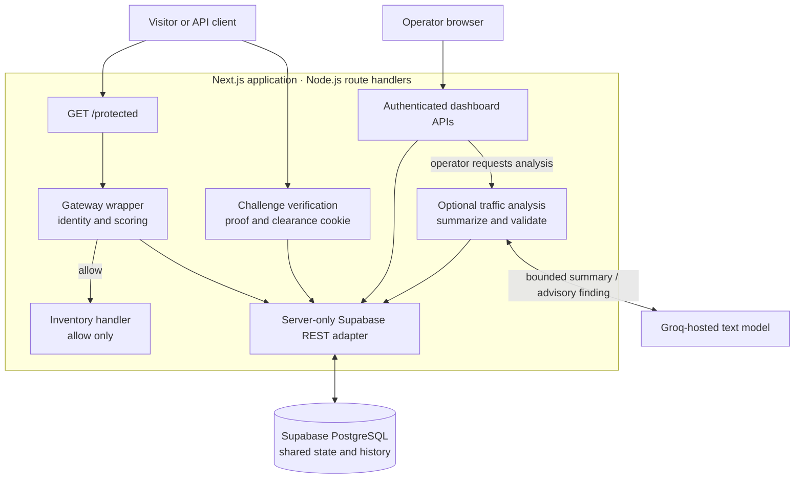
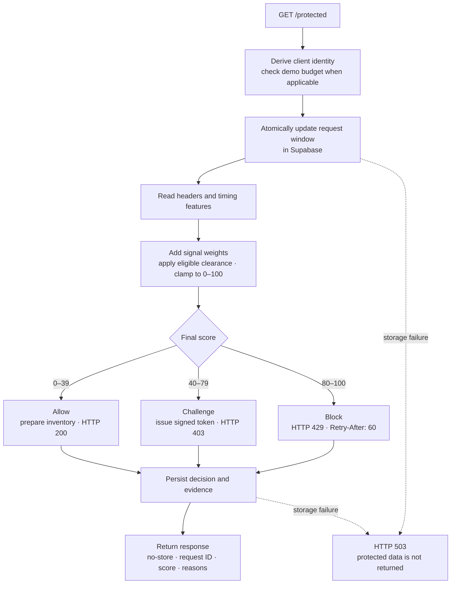
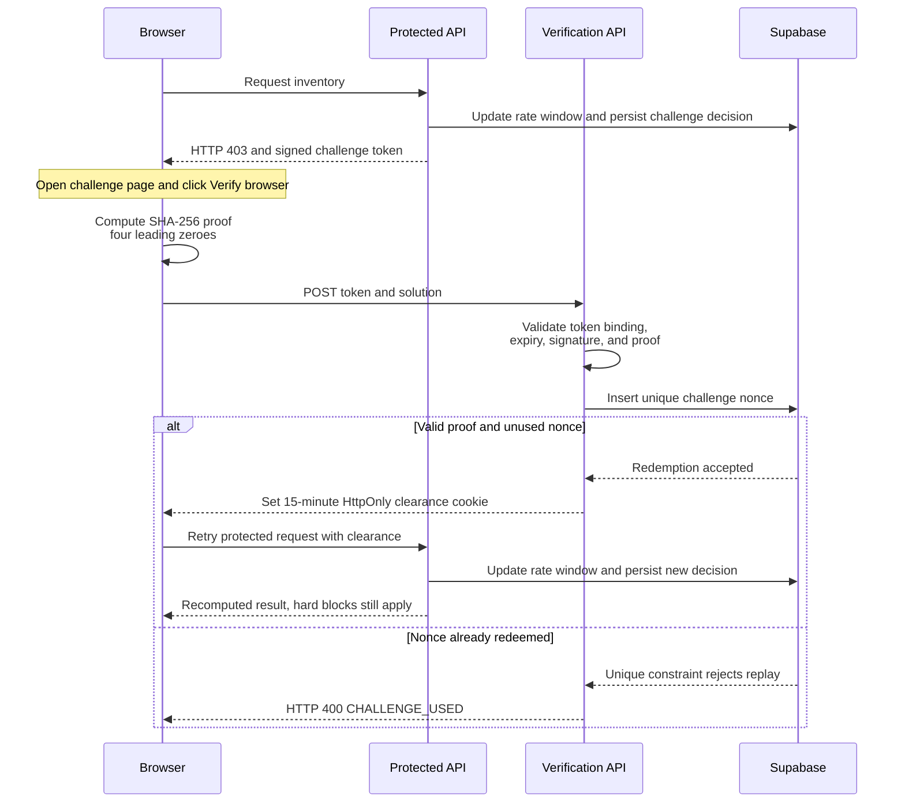
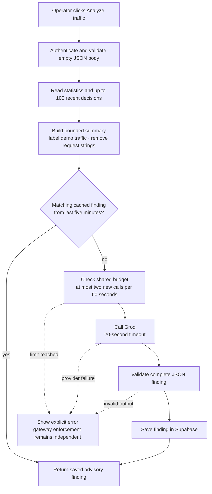

# Sentinel — Bot Detection Gateway

**Team G · Hack4Haldia '26**

Sentinel protects a demo inventory API by evaluating request headers, frequency, and timing. Each protected request receives a score, an **allow**, **challenge**, or **block** decision, and the reasons behind that decision. A dashboard shows the recorded traffic and lets judges exercise all three outcomes.

The gateway uses explicit scoring rules. An optional Groq-hosted model summarizes recent traffic for the operator; its recommendations never change request enforcement.

| At a glance | Implementation |
|---|---|
| Protected resource | `GET /protected`, returning sample inventory only when allowed |
| Decisions | Allow: **0–39** · Challenge: **40–79** · Block: **80–100** |
| State and history | Supabase PostgreSQL, shared across application instances |
| Browser challenge | SHA-256 proof of work, one-time redemption, 15-minute clearance |
| Operator console | Traffic totals, charts, decision details, filters, pagination, request inspector, guided demos |
| Application | Next.js 16, React 19, TypeScript, Tailwind CSS 4 |
| Optional traffic analysis | Groq, with `openai/gpt-oss-120b` as the default in code |

**Delivery status:** The [demo runbook](docs/DEMO_RUNBOOK.md) and [integration notes](docs/SUPABASE_SETUP.md) record completed local checks against Supabase and Groq. They still list public Vercel deployment, verification of the public URL, and final submission as outstanding. No verified public demo URL is recorded in those documents.

## Contents

- [Problem and approach](#problem-and-approach)
- [Judge walkthrough](#judge-walkthrough)
- [System architecture](#system-architecture)
- [Protected-request workflow](#protected-request-workflow)
- [Scoring rules](#scoring-rules)
- [Challenge and clearance](#challenge-and-clearance)
- [Dashboard and stored data](#dashboard-and-stored-data)
- [Optional traffic analysis](#optional-traffic-analysis)
- [API reference](#api-reference)
- [Security and privacy](#security-and-privacy)
- [Run locally](#run-locally)
- [Verification](#verification)
- [Deployment and maintenance](#deployment-and-maintenance)
- [Scope and limitations](#scope-and-limitations)
- [Repository guide](#repository-guide)

## Problem and approach

Repeated automated requests can consume API capacity and scrape application data. Blocking every script or asking every visitor to complete a challenge would also affect legitimate clients. Sentinel combines several observable signals and applies progressively stronger responses:

1. **Allow** low-scoring traffic to retrieve the inventory.
2. **Challenge** moderately suspicious traffic with a small computational task.
3. **Block** high-scoring traffic and return a retry interval.

Every completed gateway decision is stored with its evidence before the response is sent. This lets the operator inspect why a request was handled a particular way. A score indicates unusual behavior; it is not proof that a visitor is a bot.

## Judge walkthrough

Open the running application at `/` and sign in with the operator password. The following sequence uses the dashboard's existing controls.

| Step | Action | What to inspect |
|---|---|---|
| 1. Normal access | Click **1. Normal visitor** | One real request; inspect its decision, score, and returned inventory. |
| 2. Challenge | Click **2. Suspicious client** | Six requests with empty `Accept` and `Accept-Language` headers; inspect the header and rate contributions. |
| 3. Verification | Follow **Complete browser challenge**, then click **Verify browser** | The browser solves the issued challenge, submits its proof, and retries the API. The page reports the actual retry status. |
| 4. Blocking | Click **3. Burst traffic** | Exactly 24 concurrent requests; inspect blocked responses and `EXTREME_BURST` when the threshold is reached. |
| 5. Traffic analysis | Click **Analyze traffic**, if Groq is configured | Inspect the saved finding, numeric evidence, sample size, and limitations. |
| 6. Persistence and isolation | Click **Try protected API**, then refresh the dashboard | The ordinary visitor has a separate rate window; recorded decisions and findings persist. |

Each guided scenario sends actual HTTP requests to `/protected` with a fresh demo run ID. In production, only an authenticated operator can use this isolated identity. Demo requests carry a zero-weight `DEMO_TRAFFIC` reason and share a **100-request-per-60-second budget per operator IP**. Their decisions contribute to dashboard totals and are identified as simulations in traffic analysis.

Scores are calculated normally rather than selected by the demo controls. Timing, existing clearance, and request arrival times can affect outcomes. The burst has no repeat loop. See the [demo runbook](docs/DEMO_RUNBOOK.md) for presentation and recovery guidance.

## System architecture

The gateway is an application-layer wrapper, `withGateway`, used by the protected route. It is not a separate reverse-proxy service or a global filter over every page. The dashboard, API handlers, and challenge verification run in the same Next.js application; Supabase holds shared state.



The browser never receives the Supabase service key. Database access goes through server-side code. Groq is called only when the operator requests analysis and is outside the protected-request decision path.

Sources: [`lib/gateway.ts`](lib/gateway.ts), [`lib/store.ts`](lib/store.ts), [`lib/analysis.ts`](lib/analysis.ts), and [`app/protected/route.ts`](app/protected/route.ts).

## Protected-request workflow



**Identity.** The server derives an HMAC-SHA-256 key from the trusted client IP. On Vercel it uses `x-vercel-forwarded-for`. Ordinary local development requests share one identity. Authenticated demo runs derive separate keys from the operator identity and run ID.

**Shared rate state.** The `gw_record_request` database function locks the client's row while updating it, so concurrent application instances do not maintain separate counters. It retains at most 256 timestamps from the previous 60 seconds, including the current request. It returns 10-second and 60-second counts, plus timing variation from the latest eight timestamps. Counts saturate at 256, already above the hard-block thresholds.

**Persistence.** A decision record includes the request ID, timestamp, abbreviated client key, method, path, status, score, reasons, observed features, and measured processing time. The response waits for that write. A known storage or setup failure returns an error rather than protected data; it is not recorded as a successful bot decision.

## Scoring rules

Weights are added across signal groups. Within each rate window, only the highest matching tier contributes. The final score is clamped to **0–100**.

| Signal group | Observed condition | Contribution |
|---|---|---:|
| User agent | Missing or blank `User-Agent` | +25 |
| User agent | Identifies `curl`, `wget`, `python-requests`, `python-httpx`, `scrapy`, `headless`, `selenium`, or `playwright` | +15 |
| Headers | Missing or blank `Accept` | +10 |
| Headers | Missing or blank `Accept-Language` | +10 |
| 10-second rate | 6–10 requests | +25 |
| 10-second rate | 11–20 requests | +50 |
| 10-second rate | 21 or more requests | +80 |
| 60-second rate | 31–60 requests | +20 |
| 60-second rate | 61–120 requests | +45 |
| 60-second rate | 121 or more requests | +80 |
| Timing | At least five intervals and coefficient of variation below `0.15` | +15 |

The timing coefficient is the population standard deviation of recent intervals divided by their mean. Lower values mean more regular spacing. This signal is used only when enough intervals exist.

**Clearance adjustment:** If valid clearance exists and the raw score is between 1 and 79, the deduction is `min(raw, max(30, raw - 39))`. This brings the score below the challenge threshold. A raw score of **80 or higher receives no clearance reduction**. Normal traffic and demo labels have zero weight.

For example, a request with all three evaluated headers absent scores **45** and is challenged, assuming no rate or timing contribution. A request that raises the 10-second count to **21** receives at least **80** and is blocked even with valid clearance. These are rule examples, not measured detection-accuracy results.

Source of truth: [`lib/scoring.ts`](lib/scoring.ts). `/api/score` lets an authenticated operator preview these rules with validated features; actual gateway decisions always use server-observed requests.

## Challenge and clearance



- A challenge expires after **five minutes** and is bound to the client key and user agent.
- The proof is `SHA-256(token + ":" + solution)`, with four leading hexadecimal zeroes. The browser attempts at most two million candidates.
- Invalid, expired, or incorrectly bound tokens and incorrect proofs are rejected before redemption.
- A unique nonce in PostgreSQL prevents the same challenge from being redeemed across multiple application instances.
- Verification attempts are limited to **10 per 60 seconds per underlying client identity**.
- Clearance lasts **15 minutes**. The browser retries the API after verification and shows its actual response.

Proof of work adds computational cost to automation. Automated clients can also solve it; it does not establish human identity.

Sources: [`lib/challenge.ts`](lib/challenge.ts), [`app/challenge/solver.tsx`](app/challenge/solver.tsx), and [`app/api/challenge/verify/route.ts`](app/api/challenge/verify/route.ts).

## Dashboard and stored data

The console shows allowed, challenged, and blocked totals, average score, average processing time, and a traffic chart for the current minute plus the preceding 59 minute buckets. The latest decision feed refreshes on a five-second polling cycle. Operators can filter by decision, expand request evidence, and load older records using a timestamp-and-ID cursor. While browsing history, the table stops replacing its first page and statistics continue polling.

Health checks and dashboard polling are excluded from protected-resource traffic. Login, verification, demo budgets, and model budgets use separate rate-state keys. Guided demo decisions are included in traffic metrics and visibly labeled.

| Table | Stored purpose | Cleanup policy |
|---|---|---|
| `gw_clients` | Bounded request timestamps for client windows and internal budgets | Delete rows inactive for more than one day |
| `gw_decisions` | Protected-request decisions and evidence | Delete records older than seven days |
| `gw_challenges` | Redeemed nonces and challenge expiration times | Delete expired redemptions |
| `gw_analyses` | Validated findings, model name, sample metadata, and cache hash | Delete records older than seven days |

These are separate tables; the migrations do not declare foreign-key relationships between them. `gw_stats` aggregates decision records in PostgreSQL and supplies zero-filled minute buckets. Retention is applied when `gw_cleanup()` runs; the application does not schedule it automatically.

**Metric boundary:** Recorded latency includes identity/window work, scoring, and resource or challenge preparation. It excludes the final decision-log write and response delivery, so it is not end-to-end request latency.

Sources: [`components/sentinel/use-telemetry.ts`](components/sentinel/use-telemetry.ts) and the [database migrations](supabase/migrations/).

## Optional traffic analysis

The operator can request a summary of recent server-observed traffic. The server sends aggregate counts and a bounded sample to Groq, validates the returned JSON with Zod, and stores the finding. The model runs at Groq; the application does not host its weights.



The summary includes at most **100 recent requests within the statistics window** and details for the **10 largest sampled client groups**. Each selected group includes at most 12 recent observations. The payload contains numeric observations, timestamps, decisions, and allowlisted signal codes. Client groups receive temporary sample labels; raw IPs, persistent client IDs, user-agent strings, paths, cookies, and credentials are excluded from the telemetry payload.

A finding includes a classification, risk level, summary, evidence, suggested action, recommendations, and limitations. It is advisory and never changes scoring thresholds, blocks a client, or grants access. Demo traffic is explicitly described as simulation input.

Identical summaries for the same model may reuse a saved result for up to **five minutes**. A shared database budget permits at most **two new provider calls per rolling minute**; failed provider attempts also consume that budget. The history endpoint returns the five latest saved findings. Missing configuration, empty traffic, provider errors, and invalid output are reported explicitly.

Source: [`lib/analysis.ts`](lib/analysis.ts). The default model identifier is `openai/gpt-oss-120b`; `GROQ_MODEL` can select a text model available to the configured Groq account.

## API reference

An operator session is required for endpoints marked **Admin** when dashboard authentication is enabled. Production requires that authentication configuration.

| Method | Path | Access | Behavior |
|---|---|---|---|
| GET | `/health` | Public | Liveness and presence of core configuration; does not test database connectivity |
| GET | `/protected` | Gateway-evaluated | Inventory on allow; challenge on 403; block on 429 |
| POST | `/api/score` | Admin | Validate supplied features and return a scoring preview; does not authorize traffic |
| GET | `/api/stats` | Admin | Totals and 60 minute buckets |
| GET | `/api/decisions` | Admin | Persistent history; optional `limit` (1–100, default 25), `decision`, and `cursor` |
| GET | `/api/auth` | Public | Report whether authentication is required and the session is valid |
| POST | `/api/auth` | Password | Accept `{ "password": "..." }` and issue an operator session |
| DELETE | `/api/auth` | Same-origin request | Clear the operator session cookie |
| POST | `/api/challenge/verify` | Valid proof | Accept `{ "token": "...", "solution": "..." }` and set clearance |
| GET | `/api/analyses` | Admin | Latest saved findings, model identifier, and configuration presence |
| POST | `/api/analyze` | Admin | Accept `{}` and analyze server-observed traffic |

Gateway responses contain `score`, `decision`, `reasons`, and `requestId`, with `data`, `challenge`, or `retryAfter` as appropriate. Each reason has a `code`, `message`, and `weight`. Headers include `X-Request-Id`, `X-Gateway-Decision`, `X-Gateway-Score`, and `Cache-Control: no-store`. A gateway block also includes `Retry-After: 60`.

Infrastructure and validation errors use `{ "error": "...", "code": "..." }`. For example, a storage outage returns **503**, while exceeding the demo budget returns **429 `DEMO_BUDGET_LIMIT`**. An error response is distinct from a scored gateway decision, even when its HTTP status matches one.

Example scoring-preview body, using the fields in [`lib/contracts.ts`](lib/contracts.ts):

```json
{
  "userAgent": "Mozilla/5.0",
  "hasAccept": true,
  "hasAcceptLanguage": true,
  "requests10s": 1,
  "requests60s": 1,
  "intervalCount": 0,
  "intervalCv": null
}
```

## Security and privacy

- **Server-only database access:** Row-level security is enabled on all four tables; browser roles cannot read them or execute the gateway RPCs. Server credentials remain outside client bundles.
- **Pseudonymous rate tracking:** Raw IP addresses are not persisted. Decision records retain a 16-character prefix of the HMAC client key. They do retain the bounded user-agent string, request path, and scoring features; this is not a claim that no request metadata is stored.
- **Signed sessions and proofs:** Tokens use HMAC signatures and expiration checks. Operator sessions last eight hours. Session and clearance cookies are `HttpOnly`, `SameSite=Strict`, and `Secure` in production.
- **Bounded entry points:** Login and proof verification each permit 10 attempts per rolling minute per client identity. JSON readers enforce an 8 KB body limit. Mutation handlers check request origin.
- **Explicit trust boundary:** Vercel uses its platform-overwritten client-IP header. Other production deployments require an explicitly trusted proxy that overwrites `x-forwarded-for`.
- **Storage failures:** Known setup or storage failures return 503 instead of serving protected data. There is no in-memory application-storage fallback.

Sources: [`lib/security.ts`](lib/security.ts), [`lib/auth.ts`](lib/auth.ts), [`lib/errors.ts`](lib/errors.ts), and the [database migrations](supabase/migrations/).

## Run locally

Requires **Node.js 24 LTS**, matching the repository's pinned `24.x` runtime, npm, and a configured Supabase project. Groq is optional for request protection and required only for traffic analysis.

```bash
git clone https://github.com/TANKominator5/TEAM-G-Working.git
cd TEAM-G-Working
git switch team-g-solution
npm ci
```

Copy `.env.example` to `.env.local` in the repository root (`cp .env.example .env.local` in Bash, or `Copy-Item .env.example .env.local` in PowerShell). Keep an existing configured file rather than overwriting it. Generate a signing secret, for example:

```bash
node -e "console.log(require('node:crypto').randomBytes(32).toString('hex'))"
```

| Environment variable | Required for | Value or behavior |
|---|---|---|
| `SUPABASE_URL` | Core gateway | Supabase project HTTPS URL |
| `SUPABASE_SERVICE_ROLE_KEY` | Core gateway | Server secret key (`sb_secret_...`) or legacy service-role JWT |
| `GATEWAY_SECRET` | Signing and identity | Random secret of at least 32 characters |
| `DASHBOARD_PASSWORD` | Production dashboard | Strong operator password; authentication can be disabled locally if omitted |
| `TRUST_PROXY` | Explicit proxy deployments | Leave `false` locally and on Vercel; Vercel is detected automatically |
| `GROQ_API_KEY` | Optional traffic analysis | Server-side Groq credential |
| `GROQ_MODEL` | Optional model selection | Defaults to `openai/gpt-oss-120b` |

For a **new Supabase project**, apply these files once, in order, through the SQL Editor or migration tooling:

1. [`20261029072825_core_gateway.sql`](supabase/migrations/20261029072825_core_gateway.sql)
2. [`20261029084105_ai_traffic_analyses.sql`](supabase/migrations/20261029084105_ai_traffic_analyses.sql)

The existing **BotStop** project is documented as having both migrations already applied. See [Supabase setup](docs/SUPABASE_SETUP.md) before changing it.

```bash
npm run dev
```

Open [http://localhost:3000](http://localhost:3000). Sign in, use **Try protected API**, and follow the judge walkthrough. Restart the development server after changing environment variables. Keep secrets in `.env.local` and server environment settings; never commit them or prefix them with `NEXT_PUBLIC_`.

## Verification

The repository includes unit, database, and browser regression tests:

```bash
npm test
npm run typecheck
npm run build
npx playwright install chromium
npm run test:e2e
```

| Test layer | Coverage in the repository |
|---|---|
| Scoring and gateway | Thresholds, reason weights, clearance, observed features, enforcement, persistence failures, demo budgets |
| Security and APIs | Token validation, trusted proxy behavior, origin checks, authentication, proof verification, input limits, cursor validation |
| Database | Actual migrations executed with PGlite; rolling windows, bounded state, metrics, replay rejection, permissions, cleanup |
| Traffic analysis | Payload filtering, simulation labels, schema validation, cache reuse, shared budget, provider failures |
| Chromium dashboard | Login/logout, request details, inspector, pagination with continuing statistics, filters, errors, mobile layout, advisory findings, guided demos, preserved challenge tokens |

PGlite is a test database, not a runtime fallback. Browser regression fixtures intercept traffic in Chromium; they are not served by the application or inserted into Supabase. Provider responses are mocked in regression tests.

Separately, the [integration notes](docs/SUPABASE_SETUP.md) record live local checks of Supabase persistence, challenge redemption and replay rejection, the dashboard, demo isolation, and real Groq inference with cache reuse. These recorded checks do not establish public-deployment readiness, detection accuracy, or production throughput. This README does not report a new test run or benchmark.

## Deployment and maintenance

[`vercel.json`](vercel.json) selects Next.js, `npm ci`, `npm run build`, and the Seoul function region (`icn1`). [`.vercelignore`](.vercelignore) excludes local secrets, test artifacts, and unused starter files from CLI uploads. Configure environment variables separately in Vercel; `.env.local` is not uploaded.

1. Import `TANKominator5/TEAM-G-Working` into Vercel as a Next.js project and select **`team-g-solution`** as the deployment branch.
2. Apply both database migrations to a new Supabase project, or verify the existing project's migration state.
3. Configure `SUPABASE_URL`, `SUPABASE_SERVICE_ROLE_KEY`, `GATEWAY_SECRET`, and `DASHBOARD_PASSWORD` in the relevant Vercel environment. Add `GROQ_API_KEY` for analysis and optionally `GROQ_MODEL`.
4. Leave `TRUST_PROXY=false` on Vercel. Redeploy after changing environment variables.
5. Repeat the walkthrough on the public URL: login, allow, challenge and retry, block, demo isolation, persistence, and optional analysis. `/health` alone does not verify database access or these flows.
6. Schedule `select public.gw_cleanup();` daily with Supabase Cron, or run it manually during the hackathon. Cleanup removes stale state, expired redemptions, and old decisions/findings according to the retention policies above.

For production outside Vercel, place the application behind a proxy that overwrites the client-IP header and explicitly set `TRUST_PROXY=true`. The npm production commands are `npm run build` followed by `npm start`.

The [runbook](docs/DEMO_RUNBOOK.md) identifies the submission target as `Voyage-Hack4Haldia-26/TEAM-G:main`. The submission PR should include the verified live URL, team members, features, stack, and limitations, followed by the separate organizer-platform submission.

## Scope and limitations

| Area | Current boundary |
|---|---|
| Protection scope | The inventory route is wrapped by the gateway. Other resources require explicit integration with `withGateway`. |
| Detection | Rules use headers, rate, and timing. Headers can be spoofed, legitimate scripts may look unusual, and a low score does not establish human identity. |
| Shared IPs | Ordinary clients behind the same IP share a rate budget. Local development also shares one ordinary-client identity. |
| Challenge | Computation adds cost; it cannot prove a visitor is human or bypass a hard block. |
| Throughput | Each protected request requires database work. The repository does not establish a production capacity or latency guarantee. |
| Traffic analysis | Sample-limited and advisory; it is not a separately trained bot classifier. Provider outages do not disable rule-based enforcement. |
| Network protection | Application-layer enforcement is not an edge WAF or network-level denial-of-service defense. |
| Additional features | Honeypots, richer fingerprinting, exports, Redis/Upstash rate state, and a custom trained classifier are listed as future work, not completed capabilities. |

## Repository guide

| Location | Responsibility |
|---|---|
| [`app/protected/route.ts`](app/protected/route.ts) | Gateway-wrapped sample inventory |
| [`lib/gateway.ts`](lib/gateway.ts), [`lib/scoring.ts`](lib/scoring.ts) | Request enforcement and scoring rules |
| [`lib/request-identity.ts`](lib/request-identity.ts), [`lib/security.ts`](lib/security.ts) | Client identity, demo isolation, signing, cookies, origin checks |
| [`lib/challenge.ts`](lib/challenge.ts), [`app/challenge/`](app/challenge/) | Challenge issuance, proof verification, browser solver |
| [`lib/store.ts`](lib/store.ts), [`supabase/migrations/`](supabase/migrations/) | Server-side storage adapter and SQL schema/functions |
| [`lib/contracts.ts`](lib/contracts.ts) | Shared request and response types |
| [`components/sentinel/`](components/sentinel/) | Dashboard, telemetry polling, inspector, guided demos, findings |
| [`lib/analysis.ts`](lib/analysis.ts) | Summary construction, Groq request, validation, caching, inference budget |
| [`tests/`](tests/), [`e2e/`](e2e/) | Unit/database and browser regression suites |
| [`docs/DEMO_RUNBOOK.md`](docs/DEMO_RUNBOOK.md) | Demo sequence and delivery status |
| [`docs/SUPABASE_SETUP.md`](docs/SUPABASE_SETUP.md) | Existing project setup and recorded integration checks |

`app.py`, `requirements.txt`, `script.js`, and `index.html` remain starter references. The active application is the Next.js project run by npm. The earlier [dashboard handoff](docs/FRIEND_DASHBOARD_PROMPT.md) is retained as development context; the dashboard is now integrated.

The original event instructions remain available in [the earlier README](https://github.com/TANKominator5/TEAM-G-Working/blob/f7e6011/README.md#original-hackathon-brief). Its starter commands and implementation checklist describe the original brief rather than the current application.
